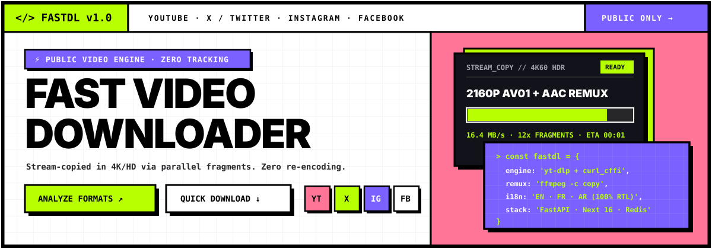
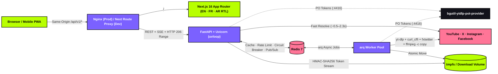
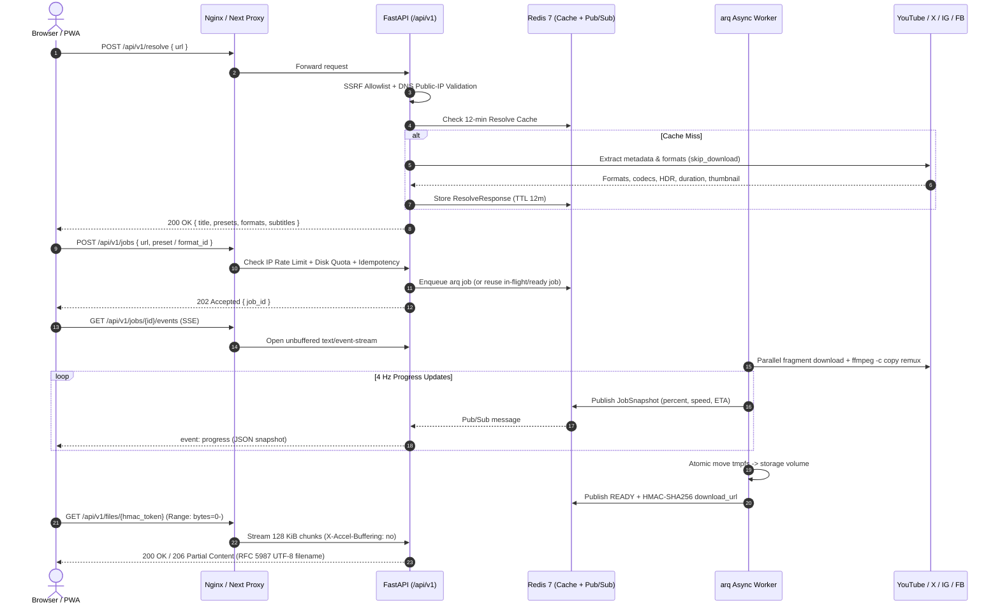

<div align="center">



<br />

[](backend/)
[](frontend/)
[](backend/app/services/extractor.py)
[](backend/app/workers/)
[](backend/app/security/)

<p align="center">
  <strong>A production-grade, privacy-first web application for downloading public, non-DRM videos from YouTube, X (Twitter), Instagram, and Facebook in the highest available quality.</strong>
</p>

<p align="center">
  <a href="#-60-second-quick-start"><strong>Quick Start</strong></a> ·
  <a href="#-bento-feature-matrix"><strong>Features</strong></a> ·
  <a href="#-system-architecture--data-flow"><strong>Architecture</strong></a> ·
  <a href="#-8-layer-anti-block-engine-l1l8"><strong>Anti-Block (L1–L8)</strong></a> ·
  <a href="#-api-reference"><strong>API Docs</strong></a> ·
  <a href="#-verified-benchmarks--smoke-results"><strong>Benchmarks</strong></a> ·
  <a href="#-makefile-command-center"><strong>Makefile</strong></a> ·
  <a href="#-configuration-reference"><strong>Env Reference</strong></a>
</p>

</div>

---

> [!IMPORTANT]
> **Legal & Scope Guardrails:** For personal use, and only for content you own or have permission to download. Users are responsible for complying with each platform's terms of service and applicable copyright law. FastDL supports **public, non-DRM media only** — it implements zero DRM circumvention, paywall bypassing, or private-account scraping.

---

## ✨ Bento Feature Matrix

<table>
  <tr>
    <td width="50%" valign="top">
      <h3>🟢 Full-Screen Neo-Brutalist UI</h3>
      <ul>
        <li><strong>Edge-to-Edge Bento Grid:</strong> Full-viewport (<code>w-full min-h-screen</code>) responsive layout across 320px mobile, tablet, laptop, and 4K ultrawide screens.</li>
        <li><strong>Dual Action Workflow:</strong> Inspect every codec, bitrate, HDR flag, and subtitle track with <code>ANALYZE FORMATS ↗</code> or trigger a one-click best-quality download via <code>QUICK DOWNLOAD ↓</code>.</li>
        <li><strong>100% Localized EN / FR / AR (RTL):</strong> Complete Arabic (<code>العربية</code>) localization with native RTL layout across every button, preset, table, error hint, and legal page.</li>
        <li><strong>Zero Server Tracking:</strong> Recent download history lives exclusively in browser <code>localStorage</code>. Ships with a PWA manifest and mobile <strong>Web Share Target</strong> (<code>/?url=...</code>).</li>
      </ul>
    </td>
    <td width="50%" valign="top">
      <h3>🟣 Zero-Transcode Media Pipeline</h3>
      <ul>
        <li><strong>Stream-Copy Remuxing:</strong> Merges highest-bitrate video and audio streams with <code>ffmpeg -c copy -movflags +faststart</code> — never re-encodes video.</li>
        <li><strong>Smart Quality Presets:</strong> <em>Best Available</em> (4K VP9/AV1/HDR in MKV/MP4), <em>Best Compatible</em> (H.264 + AAC in MP4), <code>2160p</code>, <code>1440p</code>, <code>1080p</code>, <code>720p</code>, <code>480p</code>, and Audio-Only (<code>M4A</code> lossless copy, <code>MP3 320/192 kbps</code>).</li>
        <li><strong>12x Parallel Fragments:</strong> Tuned concurrent DASH/HLS fragment downloading plus optional <code>aria2c (-x16 -s16 -k1M)</code> acceleration.</li>
        <li><strong>Live SSE Telemetry:</strong> Real-time progress percentage, download speed (MB/s), ETA, instant cancellation, and HTTP <code>206 Partial Content</code> Range streaming.</li>
      </ul>
    </td>
  </tr>
  <tr>
    <td width="50%" valign="top">
      <h3>🌸 Multi-Platform Extraction Core</h3>
      <ul>
        <li><strong>YouTube:</strong> Videos, Shorts, 4K60 HDR, live replays, and playlists (up to N items) powered by <code>bgutil-ytdlp-pot-provider</code> PO token sidecar + multi-client fallback.</li>
        <li><strong>X (Twitter):</strong> Ultra-fast (~0.5s) metadata &amp; multi-variant MP4 extraction via <code>api.fxtwitter.com</code> + direct <code>video.twimg.com</code> streaming with <code>yt-dlp</code> fallback.</li>
        <li><strong>Instagram:</strong> Public Reels, video posts, IGTV, and multi-video carousels with per-item selection.</li>
        <li><strong>Facebook:</strong> Public videos, Reels, Watch links, and <code>fb.watch</code> short links.</li>
      </ul>
    </td>
    <td width="50%" valign="top">
      <h3>⚡ Production Security &amp; DevOps</h3>
      <ul>
        <li><strong>Hop-by-Hop SSRF Guard:</strong> Strict hostname allowlist + custom DNS resolver rejecting private, loopback, link-local, and cloud metadata IPs on every redirect hop.</li>
        <li><strong>Signed Ephemeral Tokens:</strong> Short-lived (15 min) HMAC-SHA256 download tokens, RFC 5987 UTF-8 sanitized filenames, and zero shell command strings.</li>
        <li><strong>Hardened Separate Docker Stacks:</strong> Isolated <code>vdl-dev</code> and <code>vdl-prod</code> Compose projects; non-root (<code>10001:10001</code>), <code>read_only: true</code> rootfs, <code>cap_drop: [ALL]</code>, and tmpfs scratch disks.</li>
      </ul>
    </td>
  </tr>
</table>

---

## 🏗️ System Architecture & Data Flow



### Request & Streaming Lifecycle



---

## 🚀 60-Second Quick Start

### Prerequisites
- **Docker Engine** `>= 24.0` and **Docker Compose** `v2+`
- **GNU Make**, `curl`, `jq`, and `ffmpeg` (for running local smoke/benchmark scripts)

### 1. Local Development (`vdl-dev`)

```bash
# 1. Generate .env.dev, .env.prod (with random 32-byte HMAC secret), secrets/cookies/, and proxy_net
make setup

# 2. Build and start the development stack in the background (hot reload enabled)
make dev-d

# 3. Verify health & readiness across all 5 containers
curl -s http://localhost:8000/readyz | jq
```

| Service | Local URL | Description |
| --- | --- | --- |
| **Frontend Web App** | http://localhost:3000 | Full-screen Neo-Brutalist UI (EN / FR / AR RTL) |
| **Backend OpenAPI Docs** | http://localhost:8000/api/docs | Interactive Swagger UI for `/api/v1/*` |
| **Readiness Probe** | http://localhost:8000/readyz | Redis, `ffmpeg`, `yt-dlp`, PO token sidecar, disk & cookie health |
| **Version & Capabilities** | http://localhost:3000/api/v1/version | Active `yt-dlp`, `ffmpeg`, `curl_cffi`, and `aria2c` versions |

### 2. Production Deployment (`vdl-prod`)

Dev and prod never collide — they use separate compose files, project names (`vdl-dev` vs `vdl-prod`), `.env` files, volumes, and networks:

```bash
# One-command turnkey VPS setup for fastdownloading.solaymanbuilds.com (elmouden00den@gmail.com)
# Installs Docker if missing, generates .env.prod secrets, builds images, starts stack,
# issues Let's Encrypt HTTPS cert, enables TLS in Nginx, and installs auto-renewal cron:
make vps-setup

# Pull latest git changes, sync .env.prod, rebuild, rolling update, & auto-rollback on failure:
make update
```

- **Manual step-by-step production launch:**
  ```bash
  make setup
  make prod-build
  make prod-up
  make ssl-setup
  make prod-ps
  ```
- **Plugging into an Existing Host Nginx (`proxy_net` — Zero Published Host Ports):**
  ```bash
  make vps-setup-external
  ```
  See [docs/DEPLOY.md](docs/DEPLOY.md) and [nginx/conf.d/external-proxy-snippet.conf](nginx/conf.d/external-proxy-snippet.conf) for full Let's Encrypt TLS instructions.

---

## 🛡️ 8-Layer Anti-Block Engine (L1–L8)

Platforms aggressively challenge datacenter IPs. FastDL implements **8 configurable, observable layers** documented in depth in [docs/ANTI-BLOCK.md](docs/ANTI-BLOCK.md) and [docs/EGRESS.md](docs/EGRESS.md):

| Layer | Mechanism | Key Config / Implementation |
| --- | --- | --- |
| **L1** | **Runtime `yt-dlp` Auto-Updater** | Updates into writable `/var/lib/vdl/ytdlp-overlay` on `PYTHONPATH` with isolated subprocess self-test and atomic rollback ([updater.py](backend/app/services/updater.py)). Compatible with `read_only: true` containers. |
| **L2** | **Browser TLS/HTTP2 Impersonation** | Uses `curl_cffi` Chrome impersonation (`IMPERSONATE_TARGET=chrome`) without conflicting custom `User-Agent` headers. |
| **L3** | **YouTube PO Token Sidecar & Fallback** | Runs `brainicism/bgutil-ytdlp-pot-provider` on `:4416` + rotates across `YOUTUBE_PLAYER_CLIENTS=default,web_safari,tv,mweb,android_vr`. |
| **L4** | **Hot-Reloaded Netscape Cookies** | Optional per-platform `/run/secrets/cookies/{youtube,x,instagram,facebook}.txt` watched by `mtime`; auth failures flag expired cookies in `/readyz` ([cookies.py](backend/app/services/cookies.py)). |
| **L5** | **Egress Proxy Pool & WARP Sidecar** | Per-platform `http`/`https`/`socks5h` proxy pool with sticky/round-robin selection, failure ejection + cooldown ([proxies.py](backend/app/services/proxies.py)), plus `--profile warp` Cloudflare WARP container. |
| **L6** | **Polite Traffic Shaping & Circuit Breakers** | Redis sliding-window rate limits per IP and per platform, per-host worker semaphores, jittered backoff, and per-(platform, proxy) circuit breakers ([circuit_breaker.py](backend/app/services/circuit_breaker.py)). |
| **L7** | **Typed Error Classification & Canary** | Maps errors to `BOT_CHECK`, `LOGIN_REQUIRED`, `AGE_RESTRICTED`, `GEO_BLOCKED`, `PRIVATE`, `REMOVED`, `RATE_LIMITED`, `UNSUPPORTED`, `NETWORK` ([errors.py](backend/app/errors.py)) + daily canary monitor ([canary.py](backend/app/services/canary.py)). |
| **L8** | **Structured Observability** | Credential-redacting JSON logs ([logging_setup.py](backend/app/logging_setup.py)), `X-Request-ID`, Prometheus `/metrics` ([metrics.py](backend/app/metrics.py)), and `--profile monitoring` (Prometheus + Grafana). |

---

## 📊 Verified Benchmarks & Smoke Results

Real end-to-end execution output from `make smoke` and `make bench` running through the full stack (`http://127.0.0.1:3000/api/v1/*`) with `ffprobe` stream validation:

```text
=== FastDL Real-World Smoke Test ===
Target API: http://127.0.0.1:3000

Healthz: OK
Version: {"app_version":"1.0.0","ytdlp_version":"2026.10.26","ffmpeg_version":"5.1.9-0+deb12u1","aria2c_available":true,"curl_cffi_available":true,"pot_provider_enabled":true}

PLATFORM     | RESOLVE    | DOWNLOAD   | FFPROBE      | DETAILS
-------------+------------+------------+--------------+-----------------------------------------
youtube      | OK(2297ms) | OK         | OK           | size=533553B fmts=24 streams=av1,video,aac,audio
x            | OK(511ms)  | OK         | OK           | size=5948015B fmts=3 streams=h264,video,aac,audio
instagram    | OK(41ms)   | OK         | OK           | size=1949801B fmts=9 streams=h264,video
facebook     | OK(8ms)    | OK         | OK           | size=5388007B fmts=2 streams=h264,video,aac,audio

Summary: passed=4 platform_blocked=0 failed=0
```

```text
=== FastDL Speed Benchmark ===
Target API: http://127.0.0.1:3000

PLATFORM     | RESOLVE    | JOB_TIME   | TTFB       | AVG_MB/S   | SIZE_MB
-------------+------------+------------+------------+------------+-----------
youtube      | 0.07s      | 0.14s      | 0.030s     | 2.83       | 0.51
x            | 0.07s      | 0.14s      | 0.033s     | 16.35      | 5.67
instagram    | 0.07s      | 0.12s      | 0.026s     | 10.57      | 1.86
facebook     | 0.13s      | 0.16s      | 0.043s     | 10.55      | 5.14
```

---

## 🔌 API Reference

All API endpoints are versioned under `/api/v1` and documented via OpenAPI (`/api/openapi.json`).

| Method | Endpoint | Description |
| --- | --- | --- |
| `GET` | `/healthz` | Liveness probe (`200 OK {"status": "ok"}`) |
| `GET` | `/readyz` | Readiness probe checking Redis, `ffmpeg`, `yt-dlp`, PO token sidecar, disk space, and cookies |
| `GET` | `/api/v1/version` | Active app, `yt-dlp`, and `ffmpeg` versions + runtime feature flags |
| `POST` | `/api/v1/resolve` | Validate URL, detect platform, and return cached metadata, presets, formats, and subtitles |
| `POST` | `/api/v1/jobs` | Enqueue an async download job (idempotent per normalized URL + format options) |
| `GET` | `/api/v1/jobs/{id}` | Current job status snapshot (`queued`, `downloading`, `merging`, `ready`, `failed`, `cancelled`) |
| `GET` | `/api/v1/jobs/{id}/events` | Server-Sent Events (`text/event-stream`) live progress stream |
| `GET` | `/api/v1/files/{token}` | HMAC-signed media/subtitle/thumbnail download with HTTP `Range` (`206`) & RFC 5987 filename |
| `DELETE` | `/api/v1/jobs/{id}` | Cancel an active job and immediately purge its temporary/final files from disk |

<details>
<summary><strong>📌 Click to expand cURL Examples &amp; Error Schema</strong></summary>

#### 1. Resolve a Video URL
```bash
curl -sS -X POST http://localhost:3000/api/v1/resolve \
  -H "Content-Type: application/json" \
  -d '{"url": "https://x.com/ilanzraee/status/2123872904035365018"}' | jq
```

#### 2. Create a Download Job
```bash
curl -sS -X POST http://localhost:3000/api/v1/jobs \
  -H "Content-Type: application/json" \
  -d '{"url": "https://x.com/ilanzraee/status/2123872904035365018", "preset": "best"}' | jq
```

#### 3. Stream Live SSE Progress
```bash
curl -N http://localhost:3000/api/v1/jobs/<job_id>/events
```

#### 4. Consistent Error Schema
Every error response across the API conforms to:
```json
{
  "error": {
    "code": "RATE_LIMITED",
    "message": "Download rate limit reached for your IP.",
    "hint": "Please wait 12 seconds and try again.",
    "retryable": true
  }
}
```
</details>

---

## 🧰 Makefile Command Center

Run `make` or `make help` for colored self-documenting targets:

| Category | Command | Description |
| --- | --- | --- |
| **Bootstrap** | `make setup` | Copy `.env.dev` & `.env.prod` (auto-generates `HMAC_SECRET`), create `secrets/cookies/` & `proxy_net` |
| **Bootstrap** | `make network` | Create external Docker network (`proxy_net`) if missing |
| **Development** | `make dev` / `make dev-d` | Build and start `vdl-dev` stack (attached or detached) on `localhost:3000` & `:8000` |
| **Development** | `make dev-logs` / `make dev-down` | Follow live `vdl-dev` logs or stop the development stack |
| **Development** | `make dev-shell-api` / `make dev-shell-web` | Open an interactive shell inside the backend or frontend dev container |
| **Production** | `make vps-setup` | Turnkey VPS setup (`fastdownloading.solaymanbuilds.com` + Let's Encrypt HTTPS + auto-renew cron) |
| **Production** | `make vps-setup-external` | Turnkey VPS setup on shared external `proxy_net` (zero published host ports) |
| **Production** | `make ssl-setup` / `make ssl-renew` | Issue or renew Let's Encrypt certificate for `fastdownloading.solaymanbuilds.com` and reload Nginx |
| **Production** | `make update` / `make prod-update` | Pull latest git code, sync `.env.prod`, rebuild, rolling update, & auto-rollback on failure |
| **Production** | `make prod-build` | Build immutable production images (`vdl-backend:latest`, `vdl-frontend:latest`) |
| **Production** | `make prod-up` / `make prod-down` | Start or stop the hardened `vdl-prod` stack |
| **Production** | `make prod-restart` / `make prod-ps` | Rolling restart with healthcheck wait, or inspect production container health |
| **Production** | `make deploy` / `make rollback` | Run `make update --smoke` with 4-platform verification — or roll back to `:previous` |
| **Verification** | `make test` / `make test-int` | Run 68 backend unit tests + Vitest suite, or full FastAPI + Redis + Worker integration tests |
| **Verification** | `make lint` / `make format` | Run `ruff`, `mypy --strict`, `tsc --noEmit`, `eslint`, and `prettier` |
| **Verification** | `make audit` | Run `pip-audit` and `npm audit --audit-level=high` (0 vulnerabilities) |
| **Operations** | `make smoke` / `make bench` | Run live 4-platform download + `ffprobe` smoke test, or TTFB & MB/s speed benchmark |
| **Operations** | `make update-ytdlp` | Update `yt-dlp` inside running containers with automated self-test & rollback |
| **Operations** | `make cookies-check` | Validate mounted Netscape cookie files per platform |
| **Cleanup** | `make clean` / `make nuke` | Prune caches & stopped containers, or full reset with confirmation prompt |

---

## 📂 Monorepo Layout

```text
.
├── backend/
│   ├── pyproject.toml                 # Python 3.12+, dependencies, mypy & pytest config
│   ├── ruff.toml                      # Ruff linter & formatter rules
│   ├── requirements.txt               # Locked production Python dependencies
│   ├── requirements-dev.txt           # Locked development/test Python dependencies
│   ├── app/
│   │   ├── main.py                    # FastAPI factory, lifespan, security headers, CORS, /metrics
│   │   ├── config.py                  # Pydantic Settings v2 for all env vars
│   │   ├── logging_setup.py           # Structured JSON formatter with credential/token redaction
│   │   ├── metrics.py                 # Prometheus counters, histograms, and gauges
│   │   ├── schemas.py                 # Pydantic v2 request/response models
│   │   ├── errors.py                  # Typed AppError & yt-dlp error classifier (L7)
│   │   ├── api/                       # /healthz, /readyz, /api/v1/{version,resolve,jobs,files}
│   │   ├── security/                  # SSRF guard, RFC 5987 sanitizer, HMAC tokens, Redis rate limiter, Turnstile
│   │   ├── services/                  # MediaExtractor, fxtwitter fast-path, cookies, proxies, circuit breaker, storage, updater, canary
│   │   └── workers/                   # arq async worker tasks & cron jobs (cleanup, yt-dlp updater, canary)
│   └── tests/
│       ├── unit/                      # 68 unit tests (SSRF, formats, fxtwitter, errors, tokens, proxies, circuit breaker)
│       └── integration/               # Full API + Redis + Worker lifecycle, Range (206), SSE, cancel & rate-limit test
├── frontend/
│   ├── package.json                   # Next.js 16.4, React 19, TypeScript, Tailwind CSS, Vitest 5
│   ├── public/                        # PWA manifest.webmanifest (with Web Share Target) & Neo-Brutalist SVG icons
│   └── src/
│       ├── app/                       # Root layout, globals.css, /, /legal, /dmca, and /api/[...path]/route.ts proxy
│       ├── components/                # Header, Footer, DownloaderApp, FormatPicker, ProgressCard, HistoryDrawer, ToastContainer
│       ├── lib/                       # Typed API + SSE client, EN/FR/AR (100% RTL) i18n dictionary, platform & format helpers
│       └── __tests__/                 # Vitest unit tests
├── docker/
│   ├── backend.Dockerfile             # Multi-stage (base, dev, prod) Python 3.12 + ffmpeg + aria2 + tini + non-root user
│   ├── frontend.Dockerfile            # Multi-stage (base, dev, build, prod) Node 22 + Next standalone + non-root user
│   └── monitoring/prometheus.yml      # Prometheus scrape config
├── nginx/
│   ├── nginx.conf                     # Worker tuning, sendfile, text-only gzip, rate-limit zones, JSON access logs
│   └── conf.d/                        # app.conf (TLS-ready, proxy_buffering off for SSE & files) + external-proxy-snippet.conf
├── scripts/                           # setup.sh, smoke.sh, smoke_urls.txt, bench.sh, update_ytdlp.sh, cookies_check.sh
├── docs/                              # ARCHITECTURE.md, ANTI-BLOCK.md, EGRESS.md, DEPLOY.md, OPERATIONS.md, assets/banner.svg
├── docker-compose.dev.yml             # Project vdl-dev: hot reload, localhost ports, pot-provider sidecar
├── docker-compose.prod.yml            # Project vdl-prod: hardened read_only containers, internal network, optional profiles
├── docker-compose.prod.external-net.yml # Shared external proxy_net override (zero published host ports)
├── Makefile                           # Self-documenting workflow automation
├── .env.dev.example                   # Development environment template
└── .env.prod.example                  # Production environment template
```

---

## ⚙️ Configuration Reference

All settings are validated via Pydantic v2 in [backend/app/config.py](backend/app/config.py) and configured through `.env.dev` or `.env.prod`:

| Variable | Default | Description |
| --- | --- | --- |
| `APP_ENV` | `development` | `development`, `production`, or `test` |
| `LOG_LEVEL` | `INFO` | Log verbosity (`DEBUG`, `INFO`, `WARNING`, `ERROR`) |
| `CORS_ORIGINS` | `http://localhost:3000` | Comma-separated allowed CORS origins |
| `HMAC_SECRET` | *(generated by `make setup`)* | 32+ byte secret for HMAC-SHA256 download tokens |
| `DOWNLOAD_TOKEN_TTL_SECONDS` | `900` | Signed download link validity window (15 min) |
| `REDIS_URL` | `redis://redis:6379/0` | Redis connection URL |
| `WORKER_CONCURRENCY` | `3` | Max concurrent download jobs per worker container |
| `PER_PLATFORM_CONCURRENCY` | `2` | Semaphore cap per platform to prevent upstream starvation |
| `RESOLVE_CACHE_TTL_SECONDS` | `720` | Redis cache TTL for `/api/v1/resolve` responses (12 min) |
| `FILE_TTL_SECONDS` | `1800` | Completed file retention window before automatic cleanup (30 min) |
| `MIN_FREE_DISK_BYTES` | `1073741824` | Disk-quota guard threshold (refuses new jobs below 1 GiB free) |
| `MAX_DURATION_SECONDS` | `7200` | Max allowed media duration (2 hours) |
| `MAX_FILESIZE_BYTES` | `2147483648` | Max allowed output filesize (2 GiB) |
| `YTDLP_CONCURRENT_FRAGMENTS` | `12` | Parallel fragment connections per download (`1`–`32`) |
| `YTDLP_FORCE_IPV4` | `true` | Bind IPv4 sockets (`0.0.0.0`) to avoid Docker IPv6 blackholes |
| `ENABLE_ARIA2C` | `false` | Use `aria2c -x16 -s16 -k1M` for direct progressive HTTP downloads |
| `YTDLP_AUTO_UPDATE` | `true` (prod) | Auto-update `yt-dlp` into writable overlay with self-test & rollback |
| `YTDLP_CHANNEL` | `stable` | `stable` or `nightly` release channel |
| `IMPERSONATE_ENABLED` | `true` | Enable `curl_cffi` browser TLS/HTTP2 impersonation |
| `POT_PROVIDER_ENABLED` | `true` | Wire `bgutil-ytdlp-pot-provider` sidecar into YouTube extraction |
| `YOUTUBE_PLAYER_CLIENTS` | `default,web_safari,tv,mweb,android_vr` | Ordered YouTube player client fallback chain |
| `PROXY_URLS` | `""` | Global comma-separated proxy pool (`http://`, `socks5h://`) |
| `PROXY_URLS_{YOUTUBE,X,INSTAGRAM,FACEBOOK}` | `""` | Per-platform proxy pool overrides |
| `TURNSTILE_ENABLED` | `false` | Require Cloudflare Turnstile token on `POST /api/v1/jobs` |

---

## 📚 Documentation & Operations Guides

- 📐 **[Architecture & Risk Register](docs/ARCHITECTURE.md)** — System design, security boundaries, and mitigation matrix.
- 🛡️ **[Anti-Block Deep Dive (L1–L8)](docs/ANTI-BLOCK.md)** — How each reliability layer works and how to debug a blocked platform.
- 🌐 **[Egress IP Strategies](docs/EGRESS.md)** — Residential/ISP rotating proxies, Cloudflare WARP sidecar (`--profile warp`), and home/ISP worker tunneling.
- 🚀 **[VPS Production Deployment](docs/DEPLOY.md)** — Step-by-step DigitalOcean + Nginx + Let's Encrypt TLS and shared `proxy_net` setup.
- 🔧 **[Operations Runbook](docs/OPERATIONS.md)** — Zero-downtime `yt-dlp` updates, JSON log queries, Prometheus/Grafana alerts, and horizontal worker scaling.
