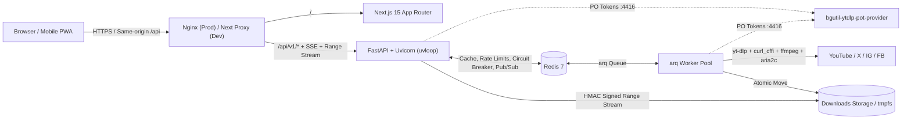

# FastDL — Production-Grade Video Downloader Web App

A fast, privacy-first, production-ready web application for downloading **public, non-DRM** videos from **YouTube**, **X (Twitter)**, **Instagram**, and **Facebook** in the highest available quality.

> **Legal Notice:** For personal use, and only for content you own or have permission to download. You are responsible for complying with each platform's terms and copyright law. No DRM circumvention, paywall bypass, or private-account scraping is implemented.

---

## Architecture



---

## Quick Start

### 1. Local Development (`vdl-dev`)

```bash
make setup
make dev-d
make dev-logs
```

- **Web App:** http://localhost:3000 (supports `?url=...` and PWA Share Target)
- **API Docs (OpenAPI):** http://localhost:8000/api/docs
- **Health / Readiness:** http://localhost:8000/healthz and http://localhost:8000/readyz

Stop dev stack:
```bash
make dev-down
```

### 2. Production (`vdl-prod`)

```bash
make setup
# Edit .env.prod: set CORS_ORIGINS, verify HMAC_SECRET, configure proxies if on a datacenter VPS
make prod-build
make prod-up
make prod-ps
```

- Uses **completely separate** Docker project name (`vdl-prod`), compose file, `.env.prod`, immutable images, named volumes, and internal network.
- See [docs/DEPLOY.md](docs/DEPLOY.md) for Let's Encrypt TLS setup and the shared external Docker network (`proxy_net`) variant with zero published host ports.

---

## Features

- **4 Platforms:** YouTube (videos, shorts, live replays, playlists), X/Twitter (highest-bitrate MP4/GIF), Instagram (public reels, posts, multi-video carousels), Facebook (videos, reels, watch, `fb.watch`), plus safe short-link resolution (`youtu.be`, `t.co`, `fb.watch`, `instagr.am`).
- **Quality Presets + Advanced List:** Best Available (4K VP9/AV1/HDR in MKV/MP4), Best Compatible (H.264/AAC MP4), 2160p/1440p/1080p/720p/480p, Audio Only (M4A no re-encode, MP3 320/192 kbps), plus full codec/fps/bitrate/size table.
- **Zero Unnecessary Transcoding:** Uses `ffmpeg -c copy` stream copy remux whenever codecs allow.
- **Live SSE Progress:** Real-time percent, speed, ETA, cancel & cleanup, automatic reconnect.
- **8-Layer Anti-Block Strategy (L1–L8):** Runtime `yt-dlp` updates with rollback, `curl_cffi` Chrome impersonation, YouTube PO token sidecar + `player_client` fallback, hot-reloaded optional cookies, rotating proxy pool + WARP sidecar, Redis rate limiting & circuit breakers, typed error classification + canary checks, Prometheus metrics + JSON logs. See [docs/ANTI-BLOCK.md](docs/ANTI-BLOCK.md).
- **Security Hardened:** Strict hostname allowlist + hop-by-hop DNS SSRF guard, zero shell strings, RFC 5987 sanitized filenames, 15-min HMAC-signed download tokens, disk-quota guard, optional Cloudflare Turnstile, non-root `read_only` containers.
- **Frontend:** Mobile-first Next.js 15 + TypeScript + Tailwind, EN / FR / AR (full RTL), dark/light system theme, `localStorage`-only history, PWA Web Share Target, `/legal` and `/dmca` pages.

---

## API Reference

| Method & Path | Description |
| --- | --- |
| `GET /healthz` | Liveness probe |
| `GET /readyz` | Readiness probe (Redis, ffmpeg, yt-dlp version, PO token sidecar, disk quota, cookie expiry) |
| `GET /api/v1/version` | App, `yt-dlp`, and `ffmpeg` versions + runtime capabilities |
| `POST /api/v1/resolve` | Validate URL, detect platform, return cached metadata, presets, formats, subtitles |
| `POST /api/v1/jobs` | Enqueue download job (idempotent per URL + format options) -> `{job_id}` |
| `GET /api/v1/jobs/{id}` | Job status snapshot |
| `GET /api/v1/jobs/{id}/events` | Server-Sent Events (SSE) live progress stream |
| `GET /api/v1/files/{token}` | HMAC-signed streamed download with HTTP `Range` (206) and RFC 5987 filename |
| `DELETE /api/v1/jobs/{id}` | Cancel job and delete temporary/final files immediately |

All errors follow `{ "error": { "code", "message", "hint", "retryable" } }`.

---

## Environment Variables Reference

| Variable | Default | Description |
| --- | --- | --- |
| `APP_ENV` | `development` | `development`, `production`, or `test` |
| `LOG_LEVEL` | `INFO` | Structured JSON log verbosity |
| `CORS_ORIGINS` | `http://localhost:3000` | Comma-separated allowed origins |
| `HMAC_SECRET` | *(generated)* | Secret key for signing download tokens (`openssl rand -hex 32`) |
| `REDIS_URL` | `redis://redis:6379/0` | Redis connection DSN |
| `WORKER_CONCURRENCY` | `3` | Max concurrent arq download jobs per worker |
| `PER_PLATFORM_CONCURRENCY` | `2` | Semaphore cap per platform |
| `RESOLVE_CACHE_TTL_SECONDS` | `720` | Resolve cache TTL (12 min) |
| `FILE_TTL_SECONDS` | `1800` | Auto-delete completed files after N seconds (30 min) |
| `DOWNLOAD_TOKEN_TTL_SECONDS` | `900` | Signed download token lifetime (15 min) |
| `MIN_FREE_DISK_BYTES` | `1073741824` | Disk-quota guard threshold (1 GiB) |
| `MAX_DURATION_SECONDS` | `7200` | Maximum video duration (2 hours) |
| `MAX_FILESIZE_BYTES` | `2147483648` | Maximum output filesize (2 GiB) |
| `YTDLP_CONCURRENT_FRAGMENTS` | `12` | Parallel DASH/HLS fragment downloads (1–32) |
| `ENABLE_ARIA2C` | `false` | Optional `aria2c -x16 -s16 -k1M` for direct HTTP formats |
| `YTDLP_AUTO_UPDATE` | `true` (prod) | Auto-update `yt-dlp` on startup/daily with self-test & rollback |
| `YTDLP_CHANNEL` | `stable` | `stable` or `nightly` |
| `YTDLP_PINNED_VERSION` | `""` | Optional pinned `yt-dlp` version |
| `IMPERSONATE_ENABLED` | `true` | Enable `curl_cffi` browser TLS/HTTP2 impersonation |
| `IMPERSONATE_TARGET` | `chrome` | Impersonation browser target |
| `POT_PROVIDER_ENABLED` | `true` | Wire `bgutil-ytdlp-pot-provider` sidecar into YouTube extractor |
| `POT_PROVIDER_URL` | `http://pot-provider:4416` | PO token sidecar URL |
| `YOUTUBE_PLAYER_CLIENTS` | `default,web_safari,tv,mweb,android_vr` | Ordered fallback player clients |
| `PROXY_URLS` | `""` | Comma-separated egress proxies (`http`/`https`/`socks5`/`socks5h`) |
| `PROXY_URLS_{YOUTUBE,X,INSTAGRAM,FACEBOOK}` | `""` | Per-platform proxy pool overrides |
| `PROXY_STRATEGY` | `sticky` | `sticky` (per-job) or `round_robin` |
| `TURNSTILE_ENABLED` | `false` | Require Cloudflare Turnstile token on `POST /api/v1/jobs` |
| `SENTRY_DSN` | `""` | Optional Sentry error tracking DSN |

---

## Useful Makefile Commands

Run `make` or `make help` to list all targets:
- `make test` / `make test-int` — unit and integration suites
- `make lint` / `make format` — ruff, mypy, eslint, prettier, tsc
- `make audit` — `pip-audit` + `npm audit`
- `make smoke` — real-world smoke tests across all 4 platforms (`scripts/smoke_urls.txt`)
- `make bench` — TTFB, total time, and average MB/s speed benchmark
- `make update-ytdlp` — runtime `yt-dlp` update with self-test & rollback
- `make cookies-check` — validate optional Netscape cookie files

---

## Troubleshooting

- **YouTube returns `BOT_CHECK` on a VPS:** Datacenter IPs are aggressively challenged by YouTube. Verify `pot-provider` is healthy in `make prod-ps`, and enable either Cloudflare WARP (`--profile warp`) or a residential/ISP proxy in `.env.prod` (see [docs/EGRESS.md](docs/EGRESS.md)).
- **Instagram/Facebook returns `LOGIN_REQUIRED`:** Meta blocks anonymous scraping from many cloud ASNs. Mount throwaway-account Netscape cookies in `secrets/cookies/instagram.txt` (hot-reloads automatically) and/or route Instagram via a residential proxy.
- **SSE progress bar stalls behind a reverse proxy:** Ensure `proxy_buffering off;` and `gzip off;` are configured on `/api/v1/jobs/*/events` (already configured in `nginx/conf.d/app.conf`).
- **Further Docs:** [Architecture](docs/ARCHITECTURE.md) · [Anti-Block Guide](docs/ANTI-BLOCK.md) · [Egress Options](docs/EGRESS.md) · [VPS Deployment](docs/DEPLOY.md) · [Operations](docs/OPERATIONS.md)
