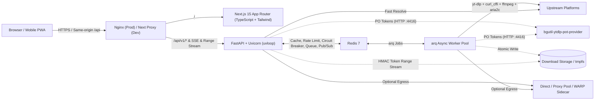

# Architecture Plan & Risk Register

## 1. System Overview

**FastDL** (Video Downloader Web App) is a production-grade, privacy-first web application for downloading public, non-DRM videos from **YouTube**, **X (Twitter)**, **Instagram**, and **Facebook**.

## 2. Core Components

1. **Backend API (`backend/app`)**
   - **FastAPI + Uvicorn (uvloop) + Pydantic v2** exposing versioned `/api/v1/*` endpoints, `/healthz`, `/readyz`, and Prometheus `/metrics`.
   - **Security layer (`app/security/`)**: Strict domain allowlist + DNS resolution SSRF guard on every redirect hop; RFC 5987 safe filename sanitization; short-lived HMAC-SHA256 download tokens; Redis token-bucket rate limiter; optional Cloudflare Turnstile verification.
   - **Extraction & Anti-Block layer (`app/services/`)**:
     - **L1**: Runtime `yt-dlp` updater installing into a versioned writable overlay on `PYTHONPATH` with automated self-test and atomic rollback (compatible with `read_only: true` non-root containers).
     - **L2**: `curl_cffi` browser TLS/HTTP2 impersonation (Chrome target) without conflicting custom UAs.
     - **L3**: YouTube PO token provider sidecar (`bgutil-ytdlp-pot-provider`) + automatic `player_client` fallback chain (`web_safari` → `tv` → `mweb` → `web` → `android_vr`).
     - **L4**: Optional hot-reloaded Netscape cookies per platform mounted via Docker secrets (`/run/secrets/cookies/{platform}.txt`), with expiry detection surfaced in `/readyz`.
     - **L5**: ProxyPool supporting `http`/`https`/`socks5`, per-platform assignment, health checks, round-robin/sticky-per-job selection, automatic ejection with cooldown, and Cloudflare WARP sidecar profile.
     - **L6**: Redis-backed per-platform/per-IP rate limiting with jittered delays, exponential backoff, and per-(platform, proxy) circuit breakers.
     - **L7**: Typed error classifier (`BOT_CHECK`, `LOGIN_REQUIRED`, `AGE_RESTRICTED`, `GEO_BLOCKED`, `PRIVATE`, `REMOVED`, `RATE_LIMITED`, `UNSUPPORTED`, `NETWORK`), multi-step recovery strategy, and daily canary monitor.
     - **L8**: Structured JSON logs with credential/token redaction, `X-Request-ID` propagation, Prometheus `/metrics`, optional Sentry.
2. **Async Worker (`backend/app/workers/`)**
   - **arq + Redis 7** with configurable job concurrency, per-host semaphore so one slow platform never starves others, live progress publishing to Redis Pub/Sub for SSE, cancellation checks, disk-quota enforcement, and cron jobs (expired file cleanup, daily `yt-dlp` update, daily canary check).
3. **Frontend (`frontend/`)**
   - **Next.js App Router + TypeScript + Tailwind CSS**, mobile-first, accessible (ARIA live regions, full keyboard navigation), dark/light system theme, EN/FR/AR i18n with full RTL support, client-only `localStorage` history, PWA manifest + Web Share Target (`/?url=...`), `/legal` and `/dmca` pages.
4. **Infrastructure (`docker/`, `nginx/`, `Makefile`)**
   - Fully separated `vdl-dev` (`docker-compose.dev.yml`) and `vdl-prod` (`docker-compose.prod.yml`) stacks, plus `docker-compose.prod.external-net.yml` for attaching to an existing host Nginx via an external Docker network with zero exposed host ports.

## 3. Risks & Mitigations

| Risk | Impact | Mitigation |
| --- | --- | --- |
| Datacenter IP blocks / login walls (YouTube, IG, FB, X) | Extraction failures | Layered L1–L8 anti-block: PO tokens, `curl_cffi` impersonation, rotating proxies, WARP sidecar, optional cookies, player-client fallback, clear user hints |
| SSRF via short links (`t.co`, `fb.watch`, `youtu.be`, `instagr.am`) | Internal network access | Manual hop-by-hop redirect resolution with hostname allowlist + DNS private/loopback/metadata IP rejection on every hop + `yt-dlp` extractor allowlist |
| Disk exhaustion from concurrent 4K downloads | Service outage | Max duration/filesize caps, pre-job free-disk guard, atomic temp-to-final moves, TTL auto-cleanup cron, immediate cleanup on cancel |
| Shell injection via video titles / URLs | RCE | Zero shell strings; Python `yt-dlp` API + `subprocess` argument lists only; strict filename sanitization |
| Runtime `yt-dlp` update failing inside read-only container | Broken extractor or container failure | Dedicated writable overlay volume on `PYTHONPATH` with automated self-test and atomic rollback to last known-good version |
| SSE / large file streaming stalled by proxy buffering | Frozen progress bar or high RAM | Nginx `proxy_buffering off`, `X-Accel-Buffering: no`, HTTP Range support, streaming generators, `gzip off` for media |
